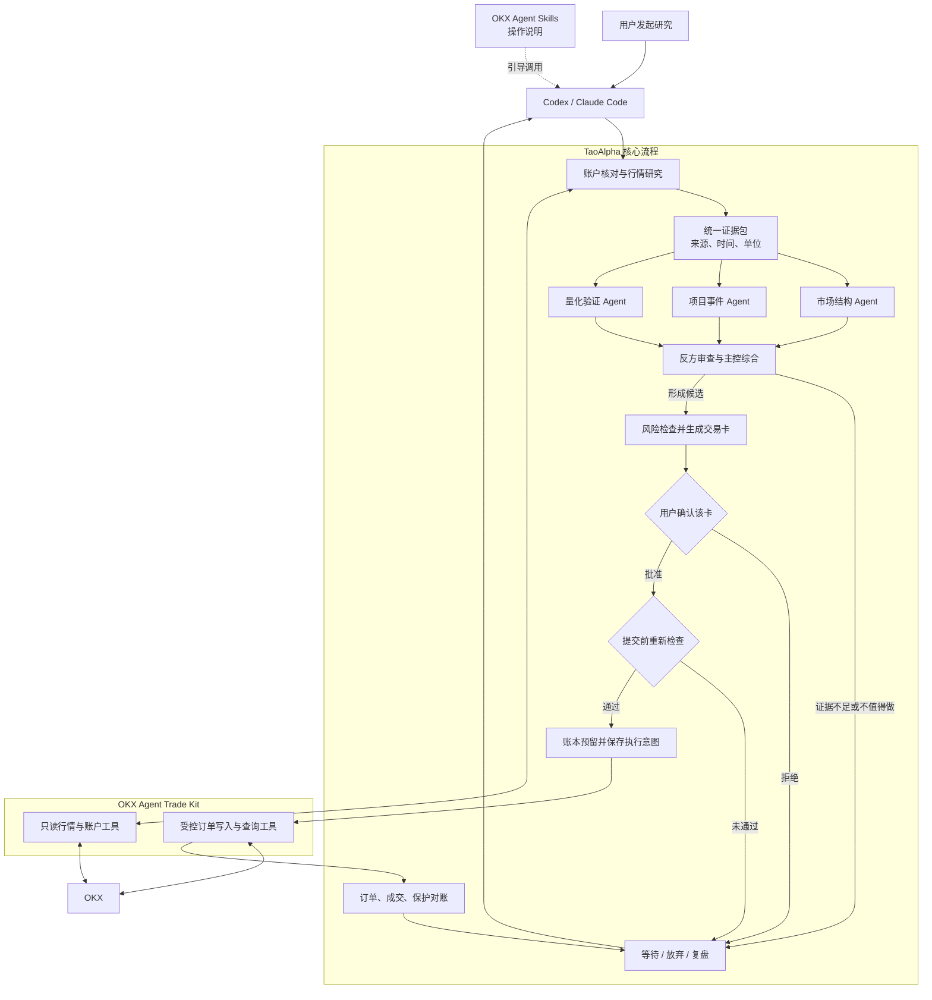

# TaoAlpha · 道枢

**让 Agent 辩论，让规则裁决，让你决定。**

TaoAlpha 是面向 Codex / Claude Code 的开源加密资产研究与人工确认交易框架。计划中的第一版支持 OKX 现货与 USDT 线性永续：多个研究角色提供可追溯的证据和异议，后端生成交易卡，用户逐单批准，受控执行端按风险规则下单并核对结果。

**状态：工程设计阶段。** 本仓库目前没有可运行的交易程序、已验证策略或实盘能力。请从以下文档了解系统边界：

- [项目地图](docs/PROJECT_MAP.md)：模块和数据流。
- [不可破坏的约束](docs/INVARIANTS.md)：资金、授权、保护与恢复规则。
- [架构决策](docs/DECISIONS.md)：选择与取舍。
- [验证方案](docs/EVALS.md)：怎样证明系统和策略达到各阶段要求。
- [Agent 协作约定](AGENTS.md)：项目级工作规则。

## 两个 OKX 项目如何配合

TaoAlpha 计划参考 OKX 的两个开源项目，把它们放在不同的层：

| 项目 | 提供什么 | TaoAlpha 怎样使用 |
|---|---|---|
| [OKX Agent Skills](https://github.com/okx/agent-skills) | Agent 调用 `okx` CLI 的操作说明，覆盖行情、账户与交易等场景 | 参考和适配行情查询、交易单位检查等流程；交易操作须遵循 TaoAlpha 的订单卡与人工批准规则 |
| [OKX Agent Trade Kit](https://github.com/okx/agent-trade-kit) | OKX 的 CLI 与 MCP 工具，负责读取行情、查询账户、发送和查询订单 | 计划由 TaoAlpha 后端适配器调用，并固定经过核验的版本 |
| TaoAlpha | 多 Agent 研究、证据记录、风险计算、交易卡、用户确认、账本与订单恢复 | 决定研究结果是否可形成交易方案，以及已批准方案能执行哪些操作 |

Agent Skills 提供操作说明，Trade Kit 提供实际的 OKX 工具。TaoAlpha 把两者接入自己的研究和执行流程。调用说明本身不授予交易权限；订单写入仍须通过 TaoAlpha 的风控和人工批准边界。两个上游项目的重叠能力在接入时按版本选择，避免重复加载或发生不同指令冲突。

第一版从公开行情和产品规则开始，建立带来源与时间的证据包；多个研究角色独立分析后，再由反方质询。只有生成的交易卡经过你确认、提交前重新通过账户与风控检查，执行层才会向 Trade Kit 发起受限操作。订单状态不明确时先查询和对账，不能直接重发开仓。

《德道经》的“知止”、承认未知与复盘修正用于研究和风险纪律，不作为币价预测信号。

预定交付顺序为只读研究、OKX 模拟环境闭环、单独审阅后的人工确认实盘。研究意见可以是**等待**或**放弃**；多 Agent 共识与《德道经》的纪律启发不构成收益证明。

Project status: design only. No trading software, validated strategy, or live trading capability is published yet.

License: MIT. See [LICENSE](LICENSE).
