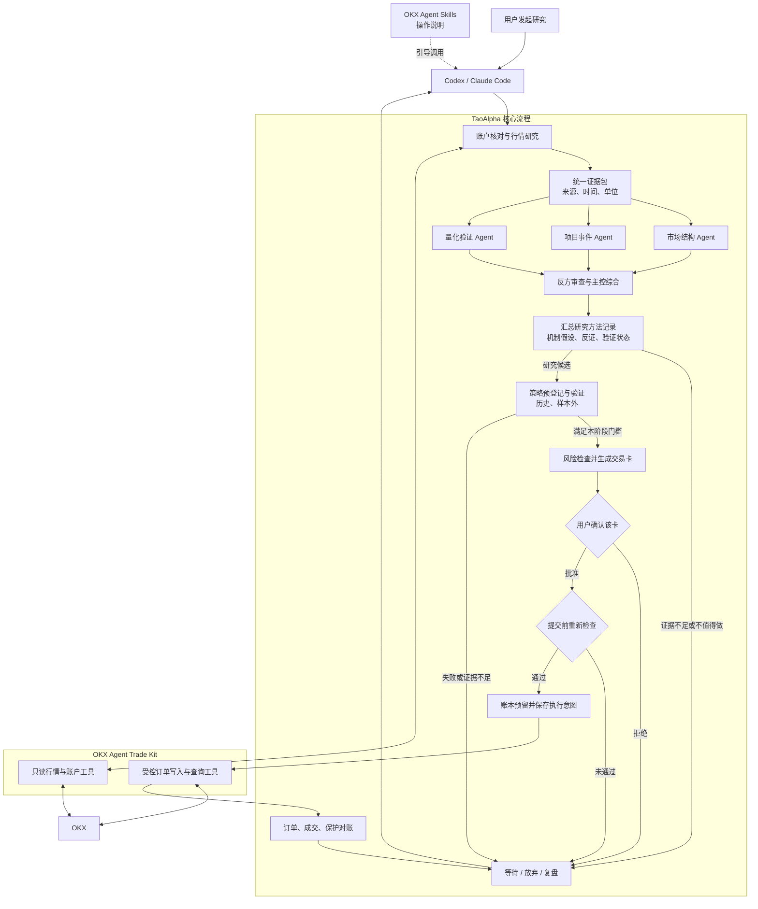

# TaoAlpha · 道枢

**让 Agent 辩论，让规则裁决，让你决定。**

TaoAlpha 是面向 Codex / Claude Code 的开源加密资产研究与人工确认交易框架。计划中的第一版支持 OKX 现货与 USDT 线性永续：多个研究角色提供可追溯的证据和异议，后端生成交易卡，用户逐单批准，受控执行端按风险规则下单并核对结果。

**状态：M0 只读研究代码已实现，M1 开发中，尚无交易能力。** 当前可以用 OKX 公共行情扫描现货与 USDT 线性永续，冻结带来源和时间的证据包，按阶段运行研究任务，并输出等待、放弃或**不可执行**的候选草稿。尚未完成真实账户核验或 OKX 模拟订单闭环；实盘禁用，策略尚未经过历史验证。宿主是否真正运行独立 Agent 也未获后端核验。

M1 已增加内部累计亏损账本、数量/组合风控、确认记录基础和固定版本 Trade Kit demo 只读适配器；真实 global demo 只读检查已有版本化记录。完整账户对账、真人确认入口联通、原子预留及模拟订单仍待完成。配置本机 demo profile 后可运行 `npm run demo:check` 取得脱敏读取状态。研究 MCP 的使用方式见 [MCP 配置](docs/MCP_SETUP.md)。

- [项目地图](docs/PROJECT_MAP.md)：模块和数据流。
- [CodeGraph 代码地图](docs/CODEGRAPH_MAP.md)：当前文件、调用链、已实现边界与后续开发落点。
- [不可破坏的约束](docs/INVARIANTS.md)：资金、授权、保护与恢复规则。
- [架构决策](docs/DECISIONS.md)：选择与取舍。
- [验证方案](docs/EVALS.md)：怎样证明系统和策略达到各阶段要求。
- [M1 开发记录](docs/M1_IMPLEMENTATION.md)：损失账本现状、模拟执行的接入顺序与证据要求。
- [OKX demo 连接配置](docs/OKX_DEMO_SETUP.md)：本机凭证配置与脱敏只读检查；尚不能下单。
- [交易研究与学习闭环规格](docs/STRATEGY_RESEARCH_SPEC.md)：三种思想如何参与机会发现、策略检验与淘汰，以及后续开发契约。
- [决策方法与原始资料](docs/research/decision-method-sources.md)：道家文本、实践论、矛盾分析的版本核对、流程映射与 OKX 公开行情样本。
- [Agent 协作约定](AGENTS.md)：项目级工作规则。

## 两个 OKX 项目如何配合

TaoAlpha 计划参考 OKX 的两个开源项目，把它们放在不同的层：

| 项目 | 提供什么 | TaoAlpha 怎样使用 |
|---|---|---|
| [OKX Agent Skills](https://github.com/okx/agent-skills) | Agent 调用 `okx` CLI 的操作说明，覆盖行情、账户与交易等场景 | 参考和适配行情查询、交易单位检查等流程；交易操作须遵循 TaoAlpha 的订单卡与人工批准规则 |
| [OKX Agent Trade Kit](https://github.com/okx/agent-trade-kit) | OKX 的 CLI 与 MCP 工具，负责读取行情、查询账户、发送和查询订单 | 计划由 TaoAlpha 后端适配器调用，并固定经过核验的版本 |
| TaoAlpha | 多 Agent 研究、证据记录、风险计算、交易卡、用户确认、账本与订单恢复 | 决定研究结果是否可形成交易方案，以及已批准方案能执行哪些操作 |

Agent Skills 提供操作说明，Trade Kit 提供实际的 OKX 工具。TaoAlpha 把两者接入自己的研究和执行流程。调用说明本身不授予交易权限；订单写入仍须通过 TaoAlpha 的风控和人工批准边界。两个上游项目的重叠能力在接入时按版本选择，避免重复加载或发生不同指令冲突。



第一版从公开行情和产品规则开始，建立带来源与时间的证据包；多个研究角色独立分析后，再由反方质询。只有生成的交易卡经过你确认、提交前重新通过账户与风控检查，执行层才会向 Trade Kit 发起受限操作。订单状态不明确时先查询和对账，不能直接重发开仓。

**M0 现状：** 公开行情由 TaoAlpha 直接以只读 GET 调用 OKX v5 公共 REST，无需签名；图中的 Trade Kit、账户、模拟和订单链路均为后续设计。需签名接口接入时再按 [ADR-006](docs/DECISIONS.md) 核验并适配 Trade Kit。

《德道经》启发选择参与和观察条件转变，《矛盾论》帮助提出具体机制与竞争解释，《实践论》组织检验、复盘和策略淘汰。方法贯穿独立研究、综合和评价，图中的方法记录是汇总输出；哲学解释不能直接充当收益证据或风控替代。未验证候选先进入策略预登记与历史检验；OKX demo 再使用卡片、确认、执行与对账链路完成模拟闭环，实盘另需用户单独启用。开发字段、Agent 职责、第一条待验证假设和验收要求见[研究与学习闭环规格](docs/STRATEGY_RESEARCH_SPEC.md)，原文版本见[来源研究](docs/research/decision-method-sources.md)。

## 快速开始（M0）

需要 Node.js 24 或更高版本。在仓库根目录运行：

```bash
npm install
npm test                 # 本地测试，不联网
npm run typecheck
npm run test:live        # 访问真实 OKX 公共行情，需网络
npm run okx -- status
npm run okx -- scan      # 将公共行情研究结果存入本地 SQLite
```

`scan` 默认使用 `data/taoalpha.db`；可用 `TAOALPHA_DB` 改为另一个本地路径。研究任务的完整操作见 [M0 研究流程](docs/research-workflow.md)。

预定交付顺序为只读研究、OKX 模拟环境闭环、单独审阅后的人工确认实盘。研究意见可以是**等待**或**放弃**；多 Agent 共识与《德道经》的纪律启发不构成收益证明。

Project status: M0 read-only research is implemented. M1 has loss-ledger, portfolio-risk and demo read-adapter foundations; no reconciled account, OKX demo order execution, validated strategy, or live trading capability is available.

License: MIT. See [LICENSE](LICENSE).
