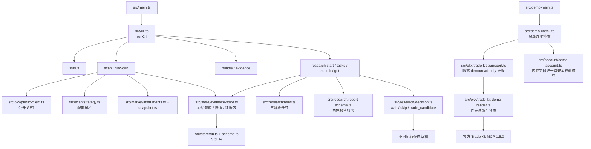

# CodeGraph 代码地图

整理日期：2026-10-28。由本仓库本地 CodeGraph 1.6.2 索引和逐符号调用链整理；它是**静态代码地图**，不是测试或 OKX 模拟环境验收报告。最后一次 `codegraph sync` 后索引覆盖 51 个 TypeScript 文件、986 个节点和 2,932 条边；`docs/`、策略 JSON 和本机 `.scratch/` 不在代码图中。工作区仍在变化，继续开发前须重新同步索引。

## 当前可追踪的主链

CLI 的实际命令为 `status`、`scan`、`bundle`、`evidence`，以及 `research start/tasks/submit/get`。`main.ts` 打开本地数据库，创建公开行情客户端，调用 `runCli` 后输出 JSON。M0 的 `status` 返回账户未连接、模拟未实现、实盘禁用、没有交易所写请求。当前公开客户端只允许向 `/api/v5/public/` 和 `/api/v5/market/` 发 GET 请求，未接入 OKX Agent Trade Kit 的账户或订单能力。

## 文件职责和实际边界

| 模块 | CodeGraph 定位 | 当前能确认的行为 | 对应下一步 |
| --- | --- | --- | --- |
| 入口 | `src/main.ts` → `src/cli.ts` | M0 研究 CLI 路由与统一返回封装；`src/demo-main.ts` 是独立的 demo 脱敏诊断入口 | Codex / Claude Code 的可信 MCP 入口仍待实现 |
| 市场读取 | `src/okx/public-client.ts`、`src/market/instruments.ts`、`src/market/snapshot.ts` | 公开 GET、产品解析；快照含报价、盘口及适用的资金费率、持仓量、标记/指数价格，逐字段留来源与时间 | 已收盘历史 K 线、可获知时间对齐和历史标的池 |
| 扫描 | `src/scan/strategy.ts` → `src/scan/scan.ts:runScan` | 加载有版本、哈希的配置；按 24h 成交额初选，再生成快照与筛选结果，保存证据包 | 当前排名不等于已验证的相对强势或历史动量策略 |
| 证据存储 | `src/store/db.ts`、`schema.ts`、`evidence-store.ts`、`audit.ts` | SQLite 保存原始响应、证据、证据包与审计；研究轮次和任务有表 | 方法记录、实验、评价与复盘的版本化存储 |
| 角色研究 | `src/research/roles.ts` → `research-service.ts` → `report-schema.ts` | 三个第一阶段角色后接反方和综合；任务绑定证据包，报告有角色结构校验，失败和重复提交有状态 | 宿主真实身份/执行模式核验、长期任务恢复及方法字段 |
| 结论 | `src/research/decision.ts:decide` | 综合输出候选、等待或跳过；缺角色、筛选失败、阻断异议会进入草稿阻断；`DraftCard.executable` 恒为 `false` | 预登记策略验证、受控交易卡、批准和执行均在后续阶段 |
| M1 损失账本（开发中） | `src/risk/loss-ledger.ts`、`src/store/schema.ts` | 内部函数记录版本化基准、已核对资金事件、净值快照和可配置的分级事件；合成测试覆盖重启与跨进程存储前提 | 缺可信账户核对、预算/仓位预留、事件恢复与受控执行；未开放 CLI/MCP 下单 |
| M1 计划风险计算（开发中） | `src/risk/entry-risk.ts` | 数量取整、面值/杠杆换算、含成本损失、预算/名额、关联加仓风险和同币 gross/net；成功也不授予执行权 | 仍需实际账户/风险版本绑定、原子预留、完整产品能力与提交重检 |
| M1 demo 读取（开发中） | `src/demo-check.ts`、`src/okx/trade-kit-transport.ts`、`trade-kit-demo-reader.ts` | 固定 demo/read-only 的官方 MCP，私有读取/分页，诊断输出脱敏；已完成 global demo 只读连接，本机握手测试本身仍不访问交易所 | 资金史、归属及自动追加核验不完整，始终未对账且不可执行 |
| M1 demo 字段归一（开发中） | `src/account/demo-account.ts` → `src/demo-check.ts` | 明确 USD/币种权益/合约张数，检查账户字段、固定 GET 来源和读取时效；CLI 不返回内部值 | 仍缺资金流水、受管范围、合约估值、保护覆盖和已确认风险版本 |

当前扫描只用现有快照计算 24h 变化率、点差、盘口深度、成交额、上市时间、完整性和时效；它不能从单次快照证明“现货资金流持续支持上涨”。`strategy.ts` 的 `validation.state` 当前只能是 `unvalidated`；量化角色报告的 `historicalValidation` 当前只能是 `not_performed`。这与[研究规格](STRATEGY_RESEARCH_SPEC.md)中待研究的相对强势策略不同。

`ResearchRunView.agentMode` 是调用者提交的运行模式，`hostVerified` 当前固定为 `false`。数据库保证任务阶段、提交去重和报告结构，不证明 Codex / Claude Code 真的启动了独立子 Agent。后续接入宿主时需建立可信能力和身份边界，再按实际运行方式更新状态。

## 后续开发落点

下表把[研究规格中的 D1—D4](STRATEGY_RESEARCH_SPEC.md)映射到现有代码，不表示这些工作已经完成。

| 阶段 | 先复用的现有节点 | 待增加的行为 |
| --- | --- | --- |
| D1 研究方法记录 | `ResearchRunView`、`AgentReport`、`Decision`、`src/store/schema.ts`、`src/cli.ts` | 在现有任务与候选链中记录主要冲突、主导方面、机制假设、竞争解释及反证；增加方法版本和引用，不另建平行研究服务 |
| D2 时序数据与实验 | `PublicClient`、`buildSnapshot`、`runScan`、`StrategyDefinition`、`EvidenceBundle` | 加入历史已收盘数据、时间对齐、历史标的池、实验冻结与尝试记录；保留当前快照来源/单位语义 |
| D3 评价报告 | `EvidenceItem`、`audit_events`、研究结论读取入口 | 新增含成本回放、样本外与基准对照的评价对象；现有 `not_performed` 不能被模型文本改成“通过” |
| D4 卡片与执行 | `Decision` 的不可执行草稿和既有工程约束 | 新增独立的账户、风控、可信批准、OKX demo/受限执行与对账能力；不在 M0 草稿上翻转 `executable` 布尔值来绕过准入 |

CodeGraph 影响路径可用于安排改动范围：

- 修改 `AgentReport` 会影响报告校验、研究服务、结论、CLI，图上对应 `test/research/decision.test.ts`、`test/research/research-service.test.ts` 和 `test/cli.test.ts`。
- 修改 `Decision` 会影响研究服务和 CLI，对应结论、研究服务和 CLI 的测试文件。
- 修改 `runScan` 会影响 CLI、研究样本构造与 `test/scan/scan.test.ts`；也需检查研究与 CLI 的调用路径。

这些是**静态影响范围**，不是测试已运行或通过的声明。开发时还需按 [EVALS](EVALS.md) 的外部行为和真实环境证据验收。

`test/store/multi-process.test.ts` 与 `test/helpers/sqlite-lock-worker.ts` 增加了两个进程共享 SQLite 文件的锁与唯一键验证。这只覆盖 M1 执行意图所需的存储前提，尚不等于批准消费、订单发送或交易所对账已实现。

`test/risk/loss-ledger.test.ts` 仅使用合成资金与净值，验证入出金剔除、阈值边界、事件持久化和数据不完整时的阻断；它不能核验真实账户资金流或模拟订单。

## 本地复查方式

CodeGraph 在仓库根目录初始化，索引存于被 Git 忽略的 `.codegraph/`。更新代码后先运行 `codegraph sync`，再用 `codegraph status` 确认索引状态。需要看调用链时用 `codegraph explore "runScan startResearch decide"`；需要精确文件和影响范围时用 `codegraph node runScan`、`codegraph impact AgentReport`。新克隆仓库可运行 `codegraph init --yes` 生成自己的本地索引。安装 CLI 不等于已安装 CodeGraph MCP；本次通过本地 CLI 建图。
