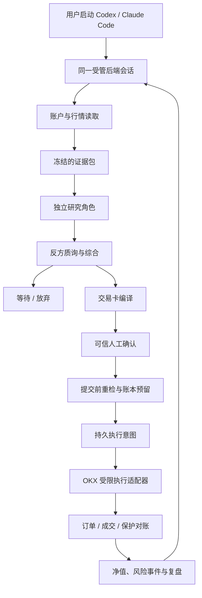

# 项目地图

## 当前状态与目标

TaoAlpha 是面向 Codex / Claude Code 的开源加密资产研究与人工确认交易框架。第一版围绕 OKX 现货与 USDT 线性永续设计：多个研究角色提供证据和反方意见，用户批准具体交易卡，后端核对风险并执行。**当前仅有工程文档；没有运行中的交易服务、策略或账户连接。**

第一版分三步交付：M0 本地只读研究；M1 OKX 模拟环境的完整订单与保护核对；M2 在真实验证和用户单独启用后允许逐单批准的实盘。M0/M1 的完成不自动推进到 M2。

## 计划中的模块

| 模块 | 责任 | 输入 → 输出 | 禁止承担 |
| --- | --- | --- | --- |
| CLI / MCP 入口 | 将 Codex、Claude Code 和本机 CLI 的请求映射到同一后端会话 | 已验证的调用上下文 → 结构化结果与中文摘要 | 在适配器内另写一套风控或私自下单 |
| Session 与账户范围 | 绑定 OKX 站点、demo/live、受管账户及能力；启动时对账 | 本机配置与交易所账户 → 不可变会话范围、差异和风险状态 | 通过请求正文临时切换成实盘 |
| 市场与账户读取器 | 采集行情、成交量、资金费、持仓量、交易规则、余额和仓位；标注单位与时间 | OKX/可追溯来源 → 版本化数据快照 | 生成用户批准或执行订单 |
| 研究编排与证据库 | 冻结证据包，分配独立角色任务，保存事实、推断、异议与失败 | 快照与策略版本 → 候选、等待或放弃 | 把票数、模型信心当作回测或概率 |
| 策略定义与验证 | 登记入场、失效、退出、成本与样本外检验规则；记录真实验证结果 | 固定版本规则与历史数据 → 可审阅验证报告 | 在看结果后无记录地改阈值 |
| 交易卡编译器 | 将候选及账户/产品规则转为完整、版本化、可核验的订单卡 | 候选引用、策略/风控版本 → 可审阅卡片或阻断原因 | 直接向交易所写入 |
| 可信人工确认入口 | 展示卡片或准入/恢复事项，验证真实用户对确定内容的决定 | 完整内容哈希与用户动作 → 不可复用决定记录 | 接受 Agent 自报的用户批准 |
| 风控与账本 | 计算净损益、预算、敞口和各事件锁；核对入出金及预留 | 账户快照、资金流、配置与意图 → 允许/阻断、风险事件 | 把计划损失当作最大实际亏损保证 |
| 执行协调器 | 消费批准、原子预留、生成持久意图、调度受限子动作、恢复未知结果 | 卡片/批准/最新状态 → 意图、订单、保护和对账状态 | 暴露自由格式交易所写入接口 |
| OKX 执行适配器 | 复用经过核验的官方工具能力，查询或执行协调器限定的子动作 | 持久子动作 → 原始响应和可核验引用 | 自行决定仓位、策略或扩大授权 |
| 报告与审计 | 汇总真实盈亏、费用、数据覆盖、研究质量、订单与异常轨迹 | 账本、证据和执行记录 → 可复核报告 | 伪造历史收益或把未知结果写成成功 |

这些是**计划中的职责**，不是已存在的代码目录。后续建目录时，以这个职责边界为准，再记录实际位置。

## 主要数据流

第一批市场结构、项目事件、量化检验角色读取同一证据版本且独立输出。随后才开放反方审查和主控综合。宿主如果不能真正调度独立 Agent，记录为能力缺口或明确降级；本地 MCP 服务本身不假装能启动宿主子 Agent。

研究输出可为等待或放弃，不必生成交易卡。卡片生成也不占预算；只有提交前重检通过后，账本才原子地消费一次批准、预留资金与名额并保存执行意图。交易所调用在数据库事务提交之后进行，恢复依靠稳定的子订单标识和对账。

## 持久对象与故障流

核心对象：`AccountScope`、`CapitalEvent`、`RiskPolicy`、`StrategyDefinition`、`MarketSnapshot`、`EvidenceItem`、`ResearchRun`、`AgentReport`、`TradePlan`、`Approval`、`ExecutionIntent`、`ExchangeOrder`、`Fill`、`ProtectionOrder`、`EquitySnapshot`、`RiskEvent`、`AuditEvent`。它们都由账户范围和版本或时间关联；密钥正文不入账本。

提交超时或进程中断时，意图保持 `unknown` 或 `reconciling`，查交易所订单、成交和保护后再判断。止损建立失败时，按原卡片授权暂停新增风险、撤销剩余入场并尝试退出**该意图新增的敞口**。真实退出未核对前继续显示未解决状态。多个客户端共享同一数据库、执行权和风险锁。

客户端关闭后，本地 Agent 和组合级触线检测不保证运行；只有交易所已经接受的保护按交易所规则继续工作。需要全天候组合监测时，另行增加常驻服务，并复用同一执行日志与授权边界。

## 仓库入口

- [AGENTS.md](../AGENTS.md)：Agent 项目级工作约定。
- [INVARIANTS.md](INVARIANTS.md)：不可破坏的业务与系统性质。
- [DECISIONS.md](DECISIONS.md)：为什么选择当前架构及何时复议。
- [EVALS.md](EVALS.md)：测试、指标及准入证据。

本仓库不发布个人账户基准、资金分配、API 凭证和本机 `.scratch/` 材料。开源实现应将预算与风险门槛设计为需要用户确认的配置。
