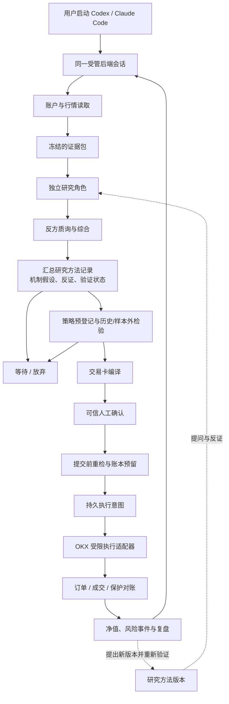

# 项目地图

## 当前状态与目标

TaoAlpha 是面向 Codex / Claude Code 的开源加密资产研究与人工确认交易框架。第一版围绕 OKX 现货与 USDT 线性永续设计：多个研究角色提供证据和反方意见，用户批准具体交易卡，后端核对风险并执行。**当前 M0 只读研究代码已实现，已有公共读取、行情扫描、证据存储、CLI 研究任务与不可执行候选草稿。** 文件存在不表示宿主独立多 Agent、策略验证或交易能力已经通过验收；完成状态须附带版本化证据。

第一版分三步交付：M0 本地只读研究；M1 OKX 模拟环境的完整订单与保护核对；M2 在真实验证和用户单独启用后允许逐单批准的实盘。M0/M1 的完成不自动推进到 M2。

## 计划中的模块

| 模块 | 责任 | 输入 → 输出 | 禁止承担 |
| --- | --- | --- | --- |
| CLI / MCP 入口 | 将 Codex、Claude Code 和本机 CLI 的请求映射到同一后端会话 | 已验证的调用上下文 → 结构化结果与中文摘要 | 在适配器内另写一套风控或私自下单 |
| Session 与账户范围 | 绑定 OKX 站点、demo/live、受管账户及能力；启动时对账 | 本机配置与交易所账户 → 不可变会话范围、差异和风险状态 | 通过请求正文临时切换成实盘 |
| 市场与账户读取器 | 采集行情、成交量、资金费、持仓量、交易规则、余额和仓位；标注单位与时间 | OKX/可追溯来源 → 版本化数据快照 | 生成用户批准或执行订单 |
| 研究编排与证据库 | 冻结证据包，分配独立角色任务，保存事实、推断、异议与失败 | 快照与策略版本 → 候选、等待或放弃 | 把票数、模型信心当作回测或概率 |
| 研究方法与学习闭环 | 在独立研究、综合、检验与复盘中组织参与条件、主要冲突/主导方面、机制假设、反证和策略修订 | 同一版本证据与角色报告 → 方法记录、预登记实验、评价与复盘 | 将哲学描述直接视为价格信号、替代确定性风控或单独裁决交易 |
| 策略定义与验证 | 登记入场、失效、退出、成本与样本外检验规则；记录真实验证结果 | 固定版本规则与历史数据 → 可审阅验证报告 | 在看结果后无记录地改阈值 |
| 交易卡编译器 | 将候选及账户/产品规则转为完整、版本化、可核验的订单卡 | 候选引用、策略/风控版本 → 可审阅卡片或阻断原因 | 直接向交易所写入 |
| 可信人工确认入口 | 展示卡片或准入/恢复事项，验证真实用户对确定内容的决定 | 完整内容哈希与用户动作 → 不可复用决定记录 | 接受 Agent 自报的用户批准 |
| 风控与账本 | 计算净损益、预算、敞口和各事件锁；核对入出金及预留 | 账户快照、资金流、配置与意图 → 允许/阻断、风险事件 | 把计划损失当作最大实际亏损保证 |
| 执行协调器 | 消费批准、原子预留、生成持久意图、调度受限子动作、恢复未知结果 | 卡片/批准/最新状态 → 意图、订单、保护和对账状态 | 暴露自由格式交易所写入接口 |
| OKX 执行适配器 | 复用经过核验的官方工具能力，查询或执行协调器限定的子动作 | 持久子动作 → 原始响应和可核验引用 | 自行决定仓位、策略或扩大授权 |
| 报告与审计 | 汇总真实盈亏、费用、数据覆盖、研究质量、订单与异常轨迹 | 账本、证据和执行记录 → 可复核报告 | 伪造历史收益或把未知结果写成成功 |

这些是**目标职责**，不是所有模块都已实现。当前可复用文件与后续能力缺口见[开发规格的代码衔接](STRATEGY_RESEARCH_SPEC.md)；后续目录和验收记录按这些职责维护。

现有 M0 调用链已由 CodeGraph 核对：`src/main.ts` → `src/cli.ts` → 扫描 `src/scan/scan.ts` 或研究 `src/research/research-service.ts` → 证据/任务存储；研究完成后由 `src/research/decision.ts` 生成等待、跳过或不可执行候选。完整文件与影响路径见[CodeGraph 代码地图](CODEGRAPH_MAP.md)。现有 CLI 不是规划中的可信 MCP 入口，研究任务也尚不能证明宿主确实运行了独立 Agent。

## M0 已实现位置

| 模块 | 位置 | 当前边界 |
| --- | --- | --- |
| 研究入口 | `src/cli.ts`、`src/main.ts`、`src/mcp/research-server.ts`、`src/mcp-main.ts` | CLI 与 MCP 复用公开行情和研究业务；不提供账户/交易写接口 |
| 公共行情读取器 | `src/okx/public-client.ts`、`src/market/` | 只发 GET，路径限于 `/api/v5/public/`、`/api/v5/market/`；不读取账户 |
| 扫描配置 | `src/scan/strategy.ts`、`config/strategies/` | 验证状态只能是 `unvalidated` |
| 扫描与证据包 | `src/scan/scan.ts`、`src/store/` | SQLite 存储；原始响应、证据、证据包及审计由触发器禁止修改和删除 |
| 研究编排 | `src/research/` | 分阶段发放任务；宿主运行方式未核验；结论只产生不可执行草稿 |
| M1 累计亏损账本（开发中） | `src/risk/loss-ledger.ts`、`src/store/schema.ts` | 内部接口记录合成基准、已核对资金流、净值快照和触线事件；未接可信账户或交易执行 |
| M1 数量与组合风控（开发中） | `src/risk/entry-risk.ts` | 纯计算取整、含成本损失、预算/名额、合并敞口；未做原子预留，不授予执行权限 |
| M1 demo 只读适配器（开发中） | `src/okx/trade-kit-demo-reader.ts`、`trade-kit-transport.ts`、`src/demo-check.ts` | 私有官方 MCP 连接、固定 demo/read-only、分页读取与脱敏诊断；已完成 global demo 只读连接，资金对账和订单闭环尚未验收 |
| M1 demo 账户字段归一（开发中） | `src/account/demo-account.ts` | 内存内区分 USD 权益、币种权益、合约张数，检查字段/来源/读取时效；CLI 仅返回校验状态，资金对账与执行仍阻断 |
| M1 demo 账户会话（开发中） | `src/account/demo-session.ts` | 固定账户身份和站点，跨会话失败及身份冲突使内部快照失效；资金/归属对账与执行仍阻断 |
| M1 确认基础（开发中） | `src/control/confirmations.ts`、`src/control/windows-presence.ts` | 请求/决定/消费持久化及系统验证适配器；尚未接入交易流程或通过真人验收 |

Session 与账户范围、交易卡编译器、确认入口与风险/执行联通、预算/仓位原子预留、执行协调器和 OKX 执行适配器仍待实现。内部风控计算和确认基础不授予执行权限。

## 主要数据流

第一批市场结构、项目事件、量化检验角色读取同一证据版本且独立输出。随后才开放反方审查和主控综合。宿主如果不能真正调度独立 Agent，记录为能力缺口或明确降级；本地 MCP 服务本身不假装能启动宿主子 Agent。

研究输出可为等待或放弃，不必生成交易卡。卡片生成也不占预算；只有提交前重检通过后，账本才原子地消费一次批准、预留资金与名额并保存执行意图。交易所调用在数据库事务提交之后进行，恢复依靠稳定的子订单标识和对账。

方法用于发现和检验机会，不限于末尾检查。未验证候选先进入策略预登记及历史/样本外检验；OKX demo 闭环复用图中的卡片、确认、执行与对账路径。实盘另需用户独立启用，每笔仍须批准。方法记录、实验、评价和复盘是相互引用的有版本研究产物；详见[交易研究与学习闭环](STRATEGY_RESEARCH_SPEC.md)。

## 持久对象与故障流

目标核心对象：`AccountScope`、`CapitalEvent`、`RiskPolicy`、`StrategyDefinition`、`MarketSnapshot`、`EvidenceItem`、`ResearchRun`、`AgentReport`、`DecisionMethodRecord`、`ExperimentDefinition`、`EvaluationReport`、`ReviewRecord`、`TradePlan`、`Approval`、`ExecutionIntent`、`ExchangeOrder`、`Fill`、`ProtectionOrder`、`EquitySnapshot`、`RiskEvent`、`AuditEvent`。它们按适用范围由账户、产品、版本或时间关联；新增研究对象的契约见[开发规格](STRATEGY_RESEARCH_SPEC.md)，不表示都已建表；密钥正文不入账本。

提交超时或进程中断时，意图保持 `unknown` 或 `reconciling`，查交易所订单、成交和保护后再判断。止损建立失败时，按原卡片授权暂停新增风险、撤销剩余入场并尝试退出**该意图新增的敞口**。真实退出未核对前继续显示未解决状态。多个客户端共享同一数据库、执行权和风险锁。

客户端关闭后，本地 Agent 和组合级触线检测不保证运行；只有交易所已经接受的保护按交易所规则继续工作。需要全天候组合监测时，另行增加常驻服务，并复用同一执行日志与授权边界。

## 仓库入口

- [AGENTS.md](../AGENTS.md)：Agent 项目级工作约定。
- [INVARIANTS.md](INVARIANTS.md)：不可破坏的业务与系统性质。
- [DECISIONS.md](DECISIONS.md)：为什么选择当前架构及何时复议。
- [EVALS.md](EVALS.md)：测试、指标及准入证据。
- [M1_IMPLEMENTATION.md](M1_IMPLEMENTATION.md)：M1 损失账本和模拟执行的当前进度与后续顺序。
- [CODEGRAPH_MAP.md](CODEGRAPH_MAP.md)：当前源码调用链、静态影响路径与能力缺口。
- [决策方法与原始资料](research/decision-method-sources.md)：哲学文本的来源版本、研究纪律映射及公开行情样本。
- [交易研究与学习闭环规格](STRATEGY_RESEARCH_SPEC.md)：盈利假设、Agent 分工、数据契约、实验与验收、后续开发顺序。

本仓库不发布个人账户基准、资金分配、API 凭证和本机 `.scratch/` 材料。开源实现应将预算与风险门槛设计为需要用户确认的配置。
