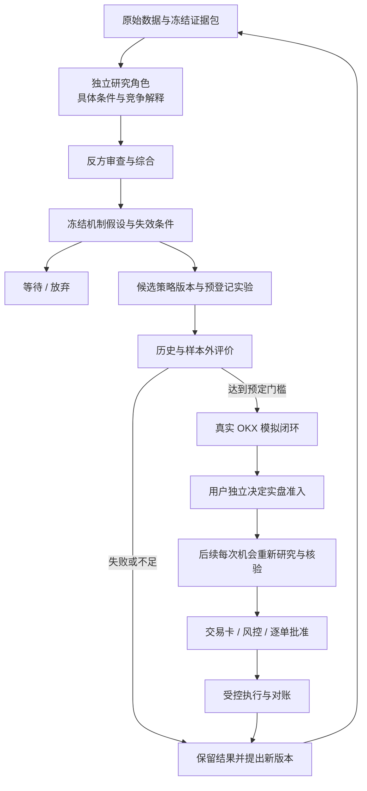

# 交易研究与学习闭环：开发规格

版本：0.2 · 整理日期：2026-10-28
本地分解标签：`ready-for-agent`，仅指研究记录、数据契约和评价流程可以拆分开发。候选策略的参数与有效性待研究，本文没有授予实盘准入或订单权限。

## 1. 目标、范围与本轮修订

产品目标是在已确认的风险边界内，寻找可重复、扣除成本后仍有价值的交易条件，并通过真实结果改进选择机会的能力。研究报告必须能够回答：收益可能来自什么机制、为什么现在值得研究、证据是否充分、怎样认定失败、需要付出多少成本和风险。

本轮将《德道经》《矛盾论》《实践论》的用途从研究末尾的纪律检查，扩展到机会发现、机制解释、条件识别、检验、复盘和策略淘汰。它们用于组织研究问题，具体买卖规则仍由可复算的策略版本定义。思想到交易方法的映射是项目设计推演，原文和版本依据见[来源研究](research/decision-method-sources.md)。

本文记录的状态必须分清：

| 内容 | 状态与开发含义 |
| --- | --- |
| 量价与资金变化优先、事件核验辅助 | 已讨论并确认的研究方向 |
| 历史验证、样本外检查、模拟闭环、人工准入、逐单批准 | 既有流程约束，见 [INVARIANTS](INVARIANTS.md) |
| 三种思想贯穿研究与学习闭环 | 本轮沉淀的设计方向；本文件细化其字段和行为 |
| 有现货成交支持的相对强势延续 | 建议优先研究的假设，尚无有效性结论；不是默认启用的策略 |
| 入场阈值、持仓窗口、样本量、统计门槛 | 待预登记的研究产物；缺项时只能形成未验证候选 |
| 个人预算、杠杆和停止线 | 继续读取私有、已确认的风险配置；公开文档不写入个人数值 |

### 现有代码衔接

以下为本次静态阅读可确认的文件，不代表运行或验收通过：

| 已有文件 | 可以复用的基础 | 本规格要求补充的内容 |
| --- | --- | --- |
| `src/okx/public-client.ts` | 公共 GET 请求、原始响应和错误结果 | 按当前站点能力增加所需读取；不能假定已覆盖全部历史接口或地区 |
| `src/market/instruments.ts` | 现货与 USDT 永续的产品解析 | 研究时点的可交易标的集合、产品历史变化和排除原因 |
| `src/market/snapshot.ts` | 报价、盘口汇总、资金费率、持仓量、标记/指数价格及逐字段来源时间 | 已收盘 K 线和对齐的时间序列；单次快照不能证明动量或资金变化 |
| `src/store/evidence-store.ts`、`src/store/schema.ts` | 原始响应、事实/推断、证据包、哈希及审计存储 | 有版本的研究记录、实验定义、评价报告、复盘及引用关系 |
| `src/scan/strategy.ts`、`src/scan/scan.ts` | M0 的有版本扫描配置、24h 排名、筛选检查及证据包 | 相对强势规则、历史标的池和预登记实验；现有排名不是已验证策略 |
| `src/research/roles.ts`、`report-schema.ts`、`research-service.ts`、`decision.ts` | 三阶段任务、角色报告校验、候选/等待/跳过结论与不可执行草稿 | 方法记录、可信宿主能力、实验与评价；当前 `hostVerified` 恒为 `false` |
| `src/main.ts`、`src/cli.ts` | M0 公开行情与研究 CLI | 未来 Codex/Claude Code 的可信 MCP 接入，不能复用 CLI 的自报角色作为身份凭证 |

快照目前的 `turnoverMethod` 区分现货报价币成交额与永续的基础币成交量乘最新价估算。研究计算必须保留这个差异，不能将两个值当成同口径的实际资金流。新增历史数据应保留精确字段、币种单位、计算方法和原始引用。

逐文件调用链及修改影响范围见[CodeGraph 代码地图](CODEGRAPH_MAP.md)。当前 `strategy.ts` 只表示 `unvalidated`，量化角色只能报告 `historicalValidation: not_performed`；仓库中的研究任务与候选草稿是已存在的 M0 基础，不需从零另建一套。

## 2. 三种思想如何形成可开发的行为

| 方法来源 | 开发中的问题 | 必须留下的记录 | 禁止替代的证据 |
| --- | --- | --- | --- |
| 《德道经》：克制、承认未知、观察条件转变 | 当前是否值得参与？是否为了收益期待强行交易？原有条件是否改变？ | 适用条件、未知项、等待/放弃原因、停止条件、流程删减的评价结果 | 不能由“反”推出涨后必跌；不能凭哲学语句生成仓位或收益概率 |
| 《矛盾论》：具体过程、主要矛盾、主要方面 | 本次研究什么过程？哪一组相互作用最可能支配价格？现在哪一方占主导？ | 研究范围、主要冲突、当前主导方面、机制假设、竞争解释、支持/反对证据、转变条件 | 持仓量增长不是新增多头占优的证明；高资金费率不是反转证明 |
| 《实践论》：经验形成认识，再接受实践检验 | 如果解释正确，应观察到什么？什么结果会推翻它？ | 事前预测、规则版本、检验窗口、成本、失败样本、验证报告与复盘 | 赢一笔不能证明机制正确；亏一笔也不能直接判定总体无效 |

“主要冲突”“当前主导方面”“机制假设”是不同字段。例如，研究某币未来一天的需求与卖出供给关系，可以把持续买盘占优作为待检验判断，再提出价格延续假设。主导方面未知时允许保留未知；不得强行填入一个哲学标签。所有因果解释均标为推断，即使引用了真实行情。

研究范围同时包含品种、产品、观察分辨率和计划评价窗口。15 分钟 K 线不等于必须持仓 15 分钟，杠杆不改变信息兑现所需的时间。短线规则失效后不得事后改称长期投资；长期项目需求、代币供给与价值捕获应登记为另一项研究。

## 3. 用户故事

1. **US-01** — As a trader, I want an explanation of where a proposed return might come from, so that I can judge whether the opportunity is worth investigating.
2. **US-02** — As a trader, I want each idea to name its asset, product and time horizon, so that short-term trades and long-term theses remain distinguishable.
3. **US-03** — As a researcher, I want to trace each claim to dated evidence or an explicit assumption, so that another person can reproduce the reasoning.
4. **US-04** — As a trader, I want competing explanations and invalidation conditions, so that I can recognize when a thesis has failed.
5. **US-05** — As a trader, I want a clear wait or skip result when data or opportunity quality is insufficient, so that opening the assistant does not force a trade.
6. **US-06** — As a researcher, I want to freeze rules and evaluation criteria before examining evaluation results, so that I can distinguish discovery from validation.
7. **US-07** — As a trader, I want estimates to include trading costs and execution limitations, so that gross gains do not hide net losses.
8. **US-08** — As a trader, I want to know which research roles actually ran and which failed, so that missing work cannot appear as agreement.
9. **US-09** — As a trader, I want unvalidated ideas to remain research candidates, so that a persuasive report cannot silently enable trading.
10. **US-10** — As a trader, I want each trade card to explain the opportunity, evidence, failure conditions, cost and risk, so that I can approve a concrete plan.
11. **US-11** — As a researcher, I want outcomes to be compared with the original prediction, so that mistakes lead to traceable revisions rather than rewritten history.
12. **US-12** — As a trader, I want the complete method compared with simpler alternatives, so that I retain only complexity that contributes measurable value.
13. **US-13** — As a researcher, I want incomplete or stale evidence and interrupted work reported explicitly, so that I can resume from a trustworthy record.
14. **US-14** — As a trader, I want strategy changes reviewed without weakening my risk rules, so that learning does not silently enlarge my exposure.

## 4. 研究与运行流程

此图区分策略生命周期与每次交易决策：一个策略版本的历史准入可以被后续研究引用，不能将旧行情快照、旧账户状态或旧卡片批准复用为本次执行依据。新的候选可以输出 `trade_candidate`，但未验证候选不能形成可执行实盘卡。

### Agent 职责

沿用既有角色，不为三部文本新增拥有执行权限的角色。

| 角色 | 本轮扩展职责 | 交付物 |
| --- | --- | --- |
| 市场结构 | 相对强势、成交支持、流动性、衍生品变化及条件转换 | 范围、计算引用、主要冲突/主导方面假设、竞争情景 |
| 项目与事件 | 第一方公告、释放计划、需求和代币经济机制的核验 | 已知事实、发布时间/生效时间、影响路径、未证实部分 |
| 量化检验 | 把机制假设变为规则与评价方案，实际执行后报告统计 | 参数版本、数据范围、费用和成交模型、基准、失败与不确定性 |
| 反方审查 | 寻找更简单解释、前视泄漏、成本侵蚀和失效条件 | 最强反证、尚未解决的阻断项、需要补充的调查 |
| 主控综合 | 汇总证据和分歧，形成候选/等待/放弃与下一步 | 五项交易理由、缺项、验证状态、版本引用 |

前三个角色先读取同一冻结证据包，随后才释放反方与综合任务。独立执行不代表统计独立，同一模型或同源数据造成的相关错误需要保留。记录 `parallel_independent`、`serial_degraded` 或 `unavailable` 等真实运行方式，不从报告数量推算胜率。

## 5. 第一条待验证的研究假设

候选方向：**有现货成交支持的相对强势延续**。此名称描述研究问题，不能作为一个已经可运行的信号。拥挤或失败信息先作为反证；独立的反转做空策略另行登记与验证，放弃做多不会自动变成做空。

| 环节 | 必须定义的规则或证据 | 参数未定时的行为 |
| --- | --- | --- |
| 标的池 | 研究时点 OKX 可用现货/USDT 线性永续、交易状态、上线历史和排除原因 | 无法重建历史标的池时标明幸存偏差，不宣称完整历史验证 |
| 可交易性 | 点差、相关价格范围内深度、交易量、最小下单量及单位 | 保留缺项；不能只凭涨幅排名判断可交易 |
| 相对强势 | 比较基准、观察窗口、收益计算与排名规则 | 只描述观察，不补造阈值；不由涨幅反推出净买入资金 |
| 现货支持 | 对齐的已收盘价格/成交量，必要时逐笔交易；现货与永续的映射关系 | 无法从成交量确认真实买盘身份；该因果解释继续标为假设 |
| 资金与拥挤 | 对齐的资金费率、未平仓量、基差及历史分布 | 无现货对应的衍生指标填 `not_applicable`，缺失填 `unknown` |
| 事件辅助 | 第一方来源、发布/可获知/生效时间；必要事件缺失时阻断 | 可选事件缺失可保留量价候选，但必须展示未知项 |
| 入场与退出 | 可复算的入场触发、取消、失效、止盈止损与评价期限 | 规则未完整登记，策略状态保持未验证 |
| 产品选择 | 同一机会下现货与永续的成本、适用窗口及风险比较 | 各类预算是上限，不要求同时使用；单个产品无优势可以跳过 |

研究优先级不等于对具体阈值的认可。流动性门槛、指标窗口、候选数量、拥挤定义、样本需求和统计标准由实验定义先固定，再查看评价区结果。需要多次探索时登记全部尝试，并给新版本安排未参与调参的评价数据。

## 6. 数据契约与持久化决策

复用 `EvidenceItem` 的事实/推断区分、`EvidenceBundle` 的冻结哈希和原始响应引用；研究字段不能代替原始证据。下表是拟扩展的领域契约，不表示对应表或接口已经实现。

| 对象 | 最小内容 | 一致性要求 |
| --- | --- | --- |
| 时序证据 | 产品/站点、周期、开收盘时间、确认状态、值与单位、原始引用、接收时间、解析/计算版本 | 已收盘策略排除未收盘 K 线；跨数据源按可获知时点对齐；保留缺口 |
| `ResearchRun` / `AgentReport` 扩展 | `methodVersion`、证据包 ID/哈希、策略版本、角色/宿主运行方式、事实/推断、失败和异议 | 同一轮不能静默替换输入或提示词；缺少身份/运行证据时不宣称独立执行已验证 |
| `DecisionMethodRecord` | `scope`、`principalConflict`、`dominantSide`、`mechanismHypothesis`、`alternativeExplanations`、`supportRefs`、`counterRefs`、`unknowns`、`invalidationConditions`、`reviewAfter`、结论及原因 | 三种思想相关输出汇总于一个有版本记录；主导方面可为未知；只有描述没有证据时仍为未验证 |
| `StrategyDefinition` / `ExperimentDefinition` | 精确规则版本、历史标的池、训练/验证/最终评价区间、尝试登记、基准、成本/成交模型、门槛、冻结时间和哈希 | 规则以策略版本为唯一来源，实验引用它；变更产生新版本，不能覆盖旧结果 |
| `EvaluationReport` | 实验/数据/代码/方法版本、运行产物引用、样本与覆盖、净收益/成本/回撤/区间估计、基准、敏感性、缺项 | 状态为 `unverified` / `insufficient` / `failed` / `passed`；状态绑定评价范围，历史通过不表示模拟或实盘通过 |
| `ReviewRecord` | 原研究/策略/计划引用、已对账的结果或模拟标记、预测偏差、成本、错误类型、变更提案 | 保留原始判断；新版本的研究不得覆盖事前记录或改变现有保护授权 |

所有新增记录保存 ID、`schemaVersion`、创建时间、内容哈希和前序引用；记录正文追加保存，状态变化由有原因的事件关联。下游必须能沿引用返回原证据或明确报缺失。金额与数量仍使用十进制定点，时间统一为明确时区的时间或 Unix 毫秒。

持久化优先延续当前 SQLite 证据与审计边界。为研究运行、方法记录、实验、评价和复盘增加关联表或受校验的 JSON 载荷，使用显式版本迁移；不能在模型自由文本里保存唯一状态，也不能关闭现有证据不可变约束。具体表字段随实现评审决定，但上述外部语义必须成立。

### 对外操作与失败结果

沿用核心后端设计的 `research.start`、`research.nextTasks`、`research.completeTask`、`research.get` 语义。它们属于拟实现业务契约，本次静态检查未确认这些入口已可调用。

| 操作 | 本轮需要具备的行为 |
| --- | --- |
| 开始研究 | 固定范围、证据包和方法/策略版本；返回运行引用、缺项和待完成任务 |
| 拉取/提交角色任务 | 同一分配重复读取不新增专家计数；校验任务身份、证据版本和报告结构；失败、超时、晚到结果明确保留 |
| 读取综合结果 | 返回候选/等待/跳过、方法记录、争议和评价状态；未验证候选不能伪装成已批准计划 |
| 登记实验并读取评价 | 写入本地研究记录；冻结规则后调用统计/回放程序，返回真实产物或失败原因，不产生交易所写请求 |
| 读取复盘 | 关联原判断与对账结果；模拟和实盘分开，给出新版本提案及需要重验的范围 |
| `plan.prepare` | 读取完整候选和相应准入证据，按环境检查适用性；缺规则、成本或验证要求时返回阻断项 |

建议稳定原因码包括 `missing_required_evidence`、`stale_evidence`、`unresolved_conflict`、`rules_incomplete`、`cost_model_missing`、`validation_insufficient`、`validation_failed`、`execution_capability_missing`。文案可以变化，原因码与证据引用必须可被 CLI/MCP 和评价程序一致读取。

研究结果、评价状态、实盘准入、用户卡片批准是不同状态轴。追加报告不能写入 Approval，也不能恢复风险锁。对已有风险的查询与已授权处置继续遵守 [INVARIANTS](INVARIANTS.md)，不因新增研究阻断而一并禁止。

## 7. 成本、统计与方法增益

单笔期望净收益可以用 `p × 平均毛盈利 − (1−p) × 平均毛亏损 − 平均净成本` 描述。这里的 p、盈亏和成本均由指定样本估计，样本及方法不足时结果为未知。若盈亏输入已经扣除某项费用，不能重复扣减；资金费按实际方向作为支出或收入。

成本模型记录入场/退出 maker 或 taker、账户费率来源或明确的研究假设、价差与滑点的计算边界、持仓跨越的资金费结算点及缺失项。用实际成交价格核算后，不再把同一价差或滑点重复作为现金费用。未接入账户费率可以用明确假设做研究和敏感性分析，不能声称它就是个人真实费率。

验证要求：

- 按时间先后划分探索、验证和最终评价，保存冻结时间、尝试次数与全部结果。重叠持仓和相关币种导致的相关性要在区间估计中考虑，交易笔数不能直接当独立样本量。
- 只使用当时可获知的数据；公告发布日期、实际可获知时间与生效时间分开。处理未收盘 K 线、退市标的和缺失区间，不回填未来信息。
- 成交假设考虑下单延迟、最小量、可见深度、限价未成交、部分成交及同根 K 线内止盈止损先后未知；不能默认每个信号都按最优价完整成交。
- 报告候选数、跳过原因、样本覆盖、净收益、费用占比、最大回撤、盈亏分布、不同市场阶段表现和成本压力情景。评价门槛必须在看评价结果前写入实验，不能在失败后改门槛让旧版本通过。
- 对比预登记的简单量价策略，以及适用时的持有/不交易基准，统一时间、标的可得性、成本和风险约束；风险暴露不等时解释差异。
- 对三种方法和多 Agent 进行对照研究：固定其他条件，比较完整流程与减少指定方法/角色后的结果；保留全部对比及调用成本，避免只展示有利组合。

准入、评价与方法效果的详细行为案例统一登记在 [EVALS](EVALS.md)。净收益改善、回撤改善、错误减少分别报告；没有盈利增益证据的研究流程仍可能有审计价值，但不能宣传为提高了收益。

## 8. 交易卡与复盘的用户可见内容

交易卡研究区固定回答五件事：

1. **收益来源**：可能产生收益的机制及竞争解释。
2. **当前条件**：为何在这个品种、产品和窗口研究，触发了哪些已登记条件。
3. **证据程度**：真实事实、推断、验证范围、关键缺失及反方意见。
4. **失效条件**：哪些观察推翻本次判断，计划何时重评；与已批准退出规则的关系。
5. **成本与风险**：毛/净预估的口径、费用、仓位和组合影响，引用已确认风险版本。

这些内容补充既有完整卡片，不替代数量、价格、保护、异常预授权、有效期和内容哈希。重新研究不能自动修改旧卡或扩大执行权限。

复盘首先识别偏差属于数据错误、机制解释失败、策略规则失败、执行偏差或尚无法判断，再提出保留/收集更多数据/新版本/停用建议。未交易候选的后续跟踪单列为模拟观察，不计为真实盈亏。暂停与硬停止仍按原有事件和人工恢复流程管理，不能靠换策略名称解锁。

## 9. 验收与开发顺序

以下是待实现行为，不是已通过的测试。优先从未来 CLI/MCP 到共享后端业务入口验收；入口尚未建立时，复用当前公开客户端、快照和证据存储边界，不另造一套运行逻辑。

| 编号 | 外部可观察结果 | 用户故事 |
| --- | --- | --- |
| MR-01 | 每个候选的五项理由能定位证据、推断和版本；无来源的因果陈述不能显示为事实 | US-01、03、10 |
| MR-02 | 研究范围缺失、长期故事替代短线失效、主导方面未知等情形有明确记录，不静默更改原窗口 | US-02、04 |
| MR-03 | 数据过期/必要来源缺失、适用字段未知和现货不适用衍生字段被区分；等待不会产生交易写请求 | US-05、13 |
| MR-04 | 跨产品时序、未收盘 K 线、公告可获知时间和历史标的池影响数据质量判定；单快照不能伪装时序趋势 | US-03、06 |
| MR-05 | 缺角色、宿主降级、错误证据哈希、晚到报告和中断均可查询；重复任务不增加共识计数 | US-08、13 |
| MR-06 | 实验与尝试在评价前登记；规则、成本或门槛变化产生新版本，旧评价不可覆盖 | US-06、11 |
| MR-07 | 费用/资金费/滑点不重复计入，成交假设和缺少真实费率可见；成本压力可使结果不通过 | US-07 |
| MR-08 | 未验证、数据不足、失败、历史通过、模拟通过和实盘准入不会混用；模型评分不能填充统计胜率 | US-09 |
| MR-09 | 对照报告展示相同条件、全部尝试、风险暴露差异、调用成本与不确定性；不能只挑有利结果 | US-12 |
| MR-10 | 修改证据、方法或策略版本导致旧研究结论需重新核验；不能自动重用旧卡批准 | US-10、14 |
| MR-11 | 复盘能回到事前判断和已对账结果；未交易跟踪、模拟和实盘分别计量，无法归因时保留未知 | US-11、13 |
| MR-12 | 候选转计划仍经既有确定性风控与人工确认；研究失败和策略换版不会改风险配置或解除停止事件 | US-09、14 |

实施可拆成四个有依赖的交付：

| 顺序 | 交付 | 完成证据 |
| --- | --- | --- |
| D1 | 扩展现有研究任务、报告和候选链，新增有版本的方法记录、原因码及可信宿主能力边界 | MR-01、02、03、05；引用可追溯且研究无交易写请求；现有任务/候选代码按新增字段适配 |
| D2 | 补充时序采集与历史标的记录，登记第一条候选策略和实验 | MR-04、06；规则与数据覆盖完整，数值参数由研究产物固定 |
| D3 | 运行含成本评价和方法对照，形成失败、不足或通过报告 | MR-07、08、09；输出真实运行产物，不预设必须得到通过结论 |
| D4 | 接入既有卡片准入、模拟执行及对账复盘 | MR-10、11、12；沿 M0/M1/M2 既定阶段逐步验收 |

## 10. 范围外与待产出项

本规格不包括自动选择实盘仓位、自动放宽风险、无用户批准开仓、上线全天候服务、增加付费数据/模型订阅、复刻全部哲学体系或本轮实现交易代码。反转做空、长期项目投资、跨交易所套利属于独立研究方向，不能借本规格自动启用。

后续开发与研究必须产出：有时间戳的历史数据覆盖清单、候选策略精确规则、实验门槛和统计方法、成本与成交假设、失败/通过报告、卡片和复盘行为证据。任何一项未具备时明确显示未完成。当前可先开发 D1，不为填满文档而编造策略数字。

## 11. 参考与阅读顺序

- [项目地图](PROJECT_MAP.md)、[不可破坏约束](INVARIANTS.md)、[架构决策 ADR-009/010](DECISIONS.md)、[验证方案](EVALS.md)。
- [原始思想文本与版本核对](research/decision-method-sources.md)：区分原文、整理本和现代交易解释。
- [OKX 手续费规则](https://www.okx.com/en-gb/help/trading-fee-rules-faq)与[资金费说明](https://www.okx.com/en-gb/help/funding-fees-for-perpetual-contracts-faq)：用于成本语义；实际账户和产品适用规则仍需接入核验。
- [Liu / Tsyvinski：Risks and Returns of Cryptocurrency](https://www.nber.org/papers/w24877)：历史样本中的动量研究线索，不能证明当前 OKX 的特定短周期策略有效。
- [Bailey 等：回测过拟合研究](https://scholarworks.wmich.edu/math_pubs/40/)：支持记录尝试、控制探索与评价边界的研究依据。

上述外部资料承接本轮对话中已核查的来源；本规格是开发整理，没有新增策略回测、模拟订单或实盘结果。
